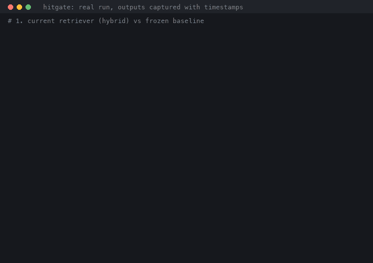

# hitgate

[](https://github.com/LucasSantana-Dev/hitgate/actions/workflows/eval.yml)


**An evaluation harness for hybrid RAG retrieval (BM25 + dense + RRF): label-free evals and a CI gate that fails when ranking regresses.**



*Real run, outputs captured with timestamps. The ~10 s eval waits are sped up and labeled.*

## Measured results

99 golden cases over this repo, pure retrieval, no reranker. Reproduce with the commands in [docs/benchmarks.md](docs/benchmarks.md).

| Retriever | Hit@1 | Hit@5 | MRR |
|---|---|---|---|
| BM25 only | **0.747** | 0.909 | **0.804** |
| Dense only | 0.646 | 0.899 | 0.744 |
| **Hybrid (BM25 + dense + RRF)** | 0.616 | **0.990** | 0.765 |

Hybrid is the only mode that keeps Hit@5 near 1.0 (+8 to +9 points). BM25 still wins Hit@1 and MRR on this identifier-heavy corpus, and that stays in the table on purpose.
On six external corpora with zero tuning, Hit@5 ranges from 0.741 to 1.0 ([benchmarks](docs/benchmarks.md)).
Self-indexed sets are optimistic by construction: use them to compare two configurations, not to certify quality.

## Install

```bash
pip install "hitgate[hybrid]"   # harness plus the bundled hybrid retriever; the core has no dependencies
```

## Quickstart

```bash
hitgate-demo .                                # index this repo, mine a golden set, measure Hit@K and MRR
hitgate-init . --output eval/golden.jsonl     # keep the golden set, curate it, freeze a baseline
hitgate-compare ci.json baseline.json         # exit 1 when any gated metric drops more than 5 points
```

The gate loop (run, freeze, compare) and how to point it at your own retriever (`--retriever mypkg:retrieve`) are in [docs/byo-retriever.md](docs/byo-retriever.md).

## What it does, and does not

- Detects retrieval regressions between two runs, with zero labeled data to start.
- Gates Hit@1/3/5, MRR and a per-intent breakdown. Plugs into any callable `(query, top, scope) -> [results]`.
- Does not measure absolute quality, and is not a framework, a hosted service or a maintained product.
- Complements answer-level tools such as RAGAS and DeepEval. It gates the retrieval layer, label-free ([comparison](docs/COMPARISONS.md)).

## Documentation

Everything else lives in [docs/](docs/README.md):

- [Bring your own retriever](docs/byo-retriever.md), [CLI reference](docs/cli-reference.md), [use cases](docs/use-cases.md)
- [Benchmarks](docs/benchmarks.md), [methodology and ablations](docs/METHODOLOGY.md), [comparisons](docs/COMPARISONS.md)
- [Langfuse guide](docs/langfuse-guide.md), [LangChain and LlamaIndex adapters](hitgate/adapters/README.md), [CI template](examples/retrieval-gate.yml)
- [Decisions](DECISIONS.md), [roadmap](ROADMAP.md), [ADRs](docs/adr/), [consolidation plan](docs/consolidation.md)

## License

MIT, see [LICENSE](LICENSE).
